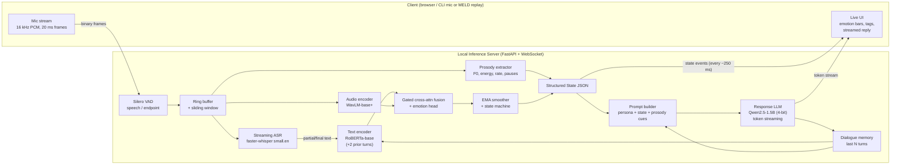
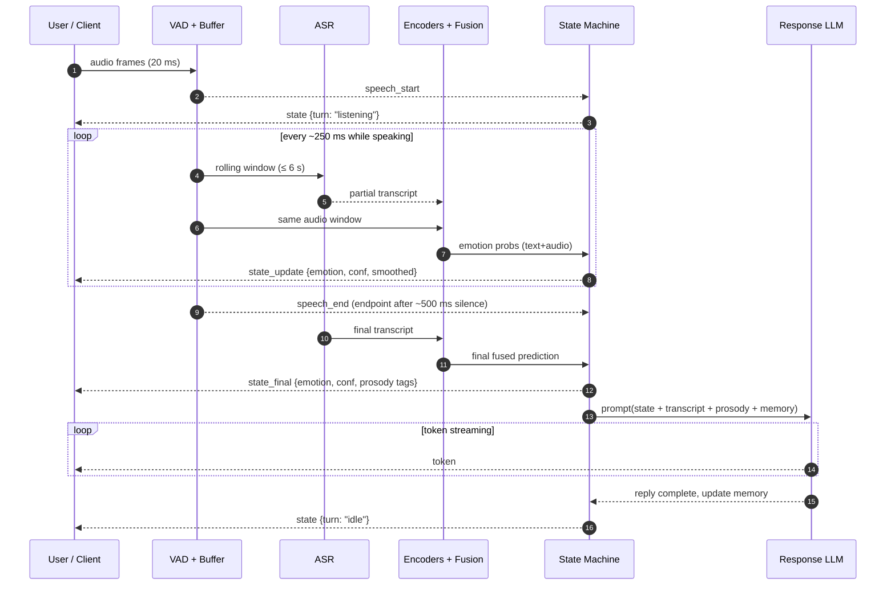
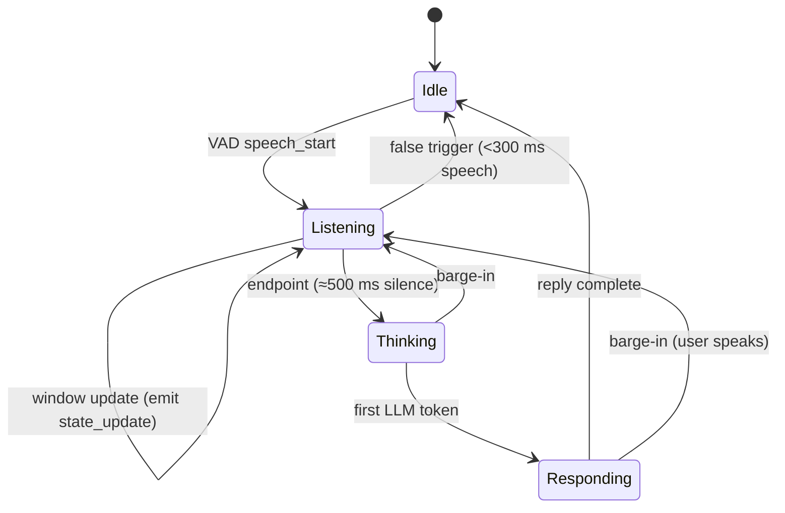
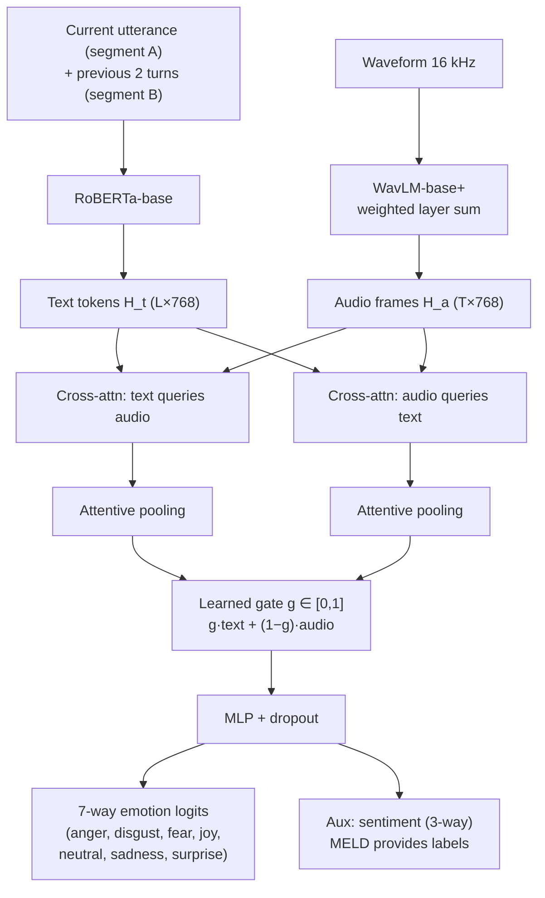
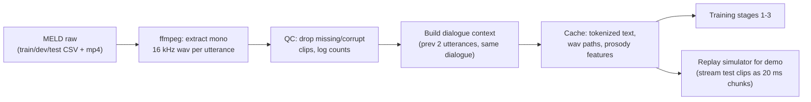
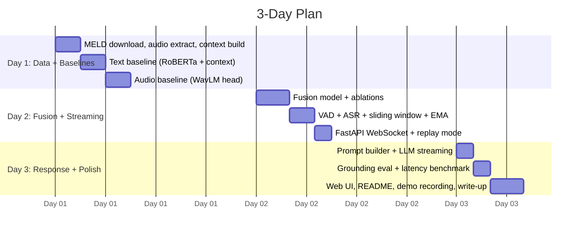

# PRD: Emotion-Aware Character Robot Prototype (Text + Audio Track)

| | |
|---|---|
| **Project** | Real-Time Multimodal ML Challenge, MELD-based prototype |
| **Primary track** | **Text + Audio** (vision left as a documented extension) |
| **Timebox** | 3 days |
| **Status** | v1.1: implemented (see §16 for deviations from the original plan) |

---

## 1. Summary

We build a small, local, streaming system. A user speaks to a character robot. The system:

1. Transcribes speech as it arrives (streaming ASR).
2. Extracts acoustic and prosodic information from the same audio.
3. Fuses **text + audio** to predict one of the 7 MELD emotions, with probabilities, updated continuously.
4. Emits a **structured state JSON** (emotion tag, confidence, arousal/valence hints, turn status).
5. Streams a **short in-character response** whose wording is conditioned on that state and on the prosody (for example, "you sound upset, though you said 'fine'").

Everything runs locally. The full inference path stays **well under 6B total parameters (~2.1B)**.

**Why text + audio is the right choice for this task:** MELD's central difficulty is that the same words ("Fine.", "Great.", "Oh, really?") map to different emotions depending on tone. Audio directly attacks that ambiguity, and audio is the natural interface for a character robot.

---

## 2. Goals, Non-Goals, Success Criteria

### 2.1 Goals
- G1. End-to-end streaming prototype: audio in over time → emotion state + streamed response out.
- G2. A fused text+audio emotion classifier **fine-tuned on MELD**, with an honest ablation (text-only vs audio-only vs fused).
- G3. Response text that is demonstrably grounded in the multimodal state (not only in the transcript).
- G4. Fully local inference, ≤ 6B total parameters, with reported hardware and latency.
- G5. Runnable repo with a one-command demo that follows one input through every stage.

### 2.2 Non-Goals (intentionally left out)
- Vision/face modality (listed as extension, not built).
- Text-to-speech (response is streamed text; TTS is a drop-in later).
- Reinforcement learning (listed as extension).
- Training large models from scratch; multi-speaker diarization; production hardening.

### 2.3 Success Criteria

| Area | Metric | Target (assumption, to be measured) |
|---|---|---|
| Accuracy | MELD test weighted-F1 (7 classes) | Fused ≥ text-only baseline by a measurable margin; report macro-F1 too |
| Accuracy | Per-class F1, esp. fear/disgust (rare) | Reported honestly with confusion matrix |
| Latency (tags) | Audio chunk in → updated emotion state out | < 300 ms on target GPU |
| Latency (reply) | End-of-utterance → first response token | < 1.0 s on target GPU |
| Throughput | Streaming real-time factor (RTF) of ASR+classifier | < 0.5 |
| Size | Total learned params in inference path | ≤ 6B (planned ≈ 2.1B) |
| Grounding | Response mentions/respects emotion tag + prosody cue | ≥ 90% on a rule-based consistency check; small manual review |
| Reproducibility | Fresh clone → demo | ≤ 15 min setup excluding downloads |

> Note on expectations: MELD is imbalanced (neutral is roughly half of utterances) and noisy (TV-show dialogue, crosstalk). Published models land in the low-to-mid 0.60s weighted-F1. We aim for a credible, well-evidenced result, not a leaderboard claim.

---

## 3. Users and Interaction Scenario

**Persona:** someone chatting with a tabletop character robot.

**Definition of "real-time" (our assumption):** conversational responsiveness, not hard real-time.
- The robot's **emotional state updates continuously while the user is speaking** (every ~250 ms hop), so an expression/LED/animation layer could react mid-sentence.
- The robot **starts replying within ~1 s of the user finishing**, a natural conversational gap.
- Streaming output (tokens as generated) lets a future TTS start speaking before the full reply exists.

**Demo scenario (the "one input traveling through the system"):**
User says, in a flat, clipped tone: *"No, it's fine."*
- Text-only model: leans `neutral`.
- Audio shows low pitch variance, high energy, fast rate → leans `anger`.
- Fusion: `anger` (0.58), `neutral` (0.27).
- Response streams: *"Hmm, that didn't sound fine to me. Want to tell me what's bugging you?"*

---

## 4. Approach

### 4.1 Key Design Decisions

| Decision | Choice | Rationale |
|---|---|---|
| Framing | Utterance-level emotion with 2-turn dialogue context | MELD is conversational; context helps text a lot |
| Streaming strategy | Sliding-window re-prediction + EMA smoothing, final prediction at endpoint | Simple, robust, no custom streaming architecture |
| Fusion | Late-ish **gated cross-attention fusion** over frozen/lightly tuned encoders | Small trainable head, fast to train in 2-3 days, good ablation story |
| Training | Staged: text → audio → fusion | Each stage is debuggable and reports its own number |
| Response generation | Small instruct LLM with structured state injected in prompt | Cheap, grounded, controllable, streams tokens |
| Quantization | 4-bit/8-bit for LLM | Lowers VRAM; parameter count is unchanged and counted in full |

### 4.2 Models and Parameter Budget

All counts are total learned parameters (not active/trainable/effective). Approximate values; the repo includes a script (`scripts/count_params.py`) that sums the actual loaded modules and prints the verified total.

| Component | Model (default) | Params | Role |
|---|---|---|---|
| VAD | Silero VAD | ~1.8M | Speech start/end detection |
| Streaming ASR | faster-whisper `small.en` (CTranslate2) | ~244M | Partial + final transcripts |
| Text encoder | `roberta-base` (fine-tuned on MELD) | ~125M | Contextual utterance embedding |
| Audio encoder | `WavLM-base-plus` (fine-tuned top layers) | ~94M | Acoustic/emotional embedding |
| Fusion + head | Gated cross-attn + MLP (new) | ~5M | 7-way emotion + valence/arousal aux |
| Prosody features | librosa/openSMILE-style (F0, energy, rate) | 0 (non-learned) | Interpretable cues for the LLM |
| Response LLM | `Qwen2.5-1.5B-Instruct` (4-bit) | ~1.54B | Grounded reply text |
| **Total** | | **≈ 2.0 to 2.1B** | **Budget 6B → ~65% headroom** |

Fallbacks if hardware is tight: `whisper base.en` (74M), `Qwen2.5-0.5B-Instruct` (~0.5B). Headroom allows an upgrade to a 3B LLM if quality needs it, still inside budget.

> External/generated components we own results for: Whisper (OpenAI, via faster-whisper), RoBERTa, WavLM, Silero VAD, Qwen2.5, MELD data, AI-assisted code. All pretrained weights are used under their licenses; fine-tuned heads and all experiments are ours.

---

## 5. System Architecture

### 5.1 High-Level Architecture



### 5.2 Streaming Sequence (one utterance end to end)



### 5.3 Turn-State Machine



### 5.4 Model Architecture (Fusion Detail)



The learned gate `g` is exposed in the output so we can show *which modality drove the decision* in the demo.

---

## 6. Data and Training Plan

### 6.1 Data Pipeline



- **Splits:** official MELD train/dev/test. Tune on dev, report once on test.
- **Class imbalance:** class-weighted cross-entropy or focal loss; report weighted-F1 and macro-F1 together.
- **Augmentation (audio):** light noise, gain, speed perturbation (±5%).
- **Note:** MELD audio comes from TV video tracks and includes laughter tracks, background music, overlapping speech. We document this as a limitation.

### 6.2 Training Stages

| Stage | What is trained | Output / evidence |
|---|---|---|
| 1. Text baseline | RoBERTa-base with 2-turn context, full fine-tune | text-only W-F1 |
| 2. Audio baseline | WavLM top layers + pooling head | audio-only W-F1 |
| 3. Fusion | Cross-attn fusion + head; encoders frozen then top layers unfrozen | fused W-F1, gate analysis |
| 4. Streaming calibration | Temperature scaling on dev; tune EMA α and window length | Calibration (ECE), stability metric |

### 6.3 Evaluation Plan

1. **Offline classification:** W-F1, macro-F1, per-class F1, confusion matrix on test.
2. **Ablations:** text-only / audio-only / fused; with vs without dialogue context; gate on vs plain concat.
3. **Streaming evaluation:** replay test clips in chunks and measure (a) accuracy vs fraction of utterance heard, (b) label flip rate with and without EMA, (c) latency percentiles (p50/p95).
4. **Grounding evaluation of responses:**
   - Rule-based: reply tone category matches emotion tag (for example, `sadness` → empathetic lexicon, not celebratory); reply references prosody cue when text/audio disagree.
   - Manual rubric on ~30 samples: grounded / generic / contradictory.
   - Contrast test: same transcript, different audio emotion → replies should differ.
5. **Resource report:** GPU/CPU, VRAM, RAM, load time, RTF, per-stage latency.

---

## 7. Interface Specification

### 7.1 Transport
WebSocket `ws://localhost:8000/stream`
- **Client → Server:** binary frames (16 kHz, 16-bit mono PCM, 20 ms) and JSON control messages (`start`, `stop`, `reset`).
- **Server → Client:** JSON events.

### 7.2 Event Schema

```json
// state_update (partial, ~every 250 ms while speaking)
{
  "type": "state_update",
  "turn": "listening",
  "t_ms": 1840,
  "partial_text": "no it's",
  "emotion": {"label": "anger", "confidence": 0.52,
              "probs": {"anger":0.52,"neutral":0.31,"sadness":0.08,"joy":0.03,
                        "surprise":0.03,"fear":0.02,"disgust":0.01}},
  "modality_weight": {"text": 0.35, "audio": 0.65}
}

// state_final (at endpoint)
{
  "type": "state_final",
  "text": "No, it's fine.",
  "emotion": {"label": "anger", "confidence": 0.58},
  "sentiment": "negative",
  "prosody": {"pitch": "low-flat", "energy": "high", "rate": "fast", "pauses": "short"},
  "mismatch": true,            // text-only top label != audio-influenced label
  "latency_ms": {"vad": 8, "asr": 210, "encode_fuse": 55}
}

// reply_token (streamed)
{"type": "reply_token", "token": "Hmm,"}

// reply_done
{"type": "reply_done", "text": "Hmm, that didn't sound fine to me. ...", "latency_ms": {"first_token": 640, "total": 1900}}
```

### 7.3 Prompt Contract (response grounding)

```
SYSTEM: You are "Pip", a warm, playful robot companion. Reply in 1-2 short sentences.
Match your tone to the user's emotional state. If words and tone disagree, gently
acknowledge the tone. Never mention probabilities or "my model".

STATE: {emotion: anger (0.58), sentiment: negative,
        prosody: low pitch variance, high energy, fast rate,
        mismatch: words sound neutral but tone sounds angry}
HISTORY: [last 3 turns]
USER SAID: "No, it's fine."
```

---

## 8. Functional Requirements

| ID | Requirement | Priority |
|---|---|---|
| FR1 | Accept streaming 16 kHz PCM over WebSocket | P0 |
| FR2 | VAD-based start/end-of-turn detection | P0 |
| FR3 | Streaming ASR with partial and final transcripts | P0 |
| FR4 | Fused text+audio MELD 7-class prediction with probabilities | P0 |
| FR5 | Continuous state updates while speaking; EMA smoothing | P0 |
| FR6 | Structured state JSON at endpoint (emotion, confidence, prosody, mismatch flag) | P0 |
| FR7 | Streaming short reply grounded in state + transcript + prosody | P0 |
| FR8 | Dialogue memory (last N turns) feeding encoder context and prompt | P1 |
| FR9 | MELD replay mode (stream a test clip as live audio) | P0 (reproducible demo) |
| FR10 | Live mic mode via browser page | P1 |
| FR11 | Barge-in handling (cancel reply on new speech) | P2 |
| FR12 | Parameter counter + latency/resource benchmark scripts | P0 |

## 9. Non-Functional Requirements
- **Local only:** no remote inference calls at runtime.
- **Param cap:** ≤ 6B total, verified by script.
- **Reproducibility:** pinned requirements, fixed seeds, config files, saved checkpoints/metrics.
- **Observability:** per-stage latency in every event; log file per session.
- **Graceful degradation:** if ASR is slow, emit audio-only emotion state first.

---

## 10. Repository Layout

```
meld-robot/
├── README.md                  # setup, run, demo, results table, limitations
├── PRD.md                     # this document
├── .gitignore  requirements.txt  pyproject.toml  Makefile
├── configs/                   # data.yaml  train.yaml  stream.yaml
├── eval_cases/grounding_cases.json
├── scripts/
│   ├── download_meld.sh       prepare_meld.py     transcribe_meld.py
│   └── count_params.py        benchmark.py
├── src/meld_robot/
│   ├── labels.py  config.py  data.py  metrics.py
│   ├── models/    fusion.py  build.py              # FusionEmotionModel (text | audio | fusion modes)
│   ├── train/     train.py                         # --stage text | audio | fusion
│   ├── eval/      offline_eval.py  streaming_eval.py  grounding_eval.py
│   ├── stream/    vad.py asr.py engine.py prosody.py state_machine.py pipeline.py factory.py
│   ├── respond/   prompt.py  llm.py                # LLM + rule-based template responder
│   └── server/    app.py                           # FastAPI + WebSocket
├── web/index.html             # mic capture, file replay, live visualisation
├── demo/replay_demo.py        # one clip through the whole system, prints every event
├── tests/                     # 21 tests (no model downloads needed)
├── data/  checkpoints/  results/   # git-ignored artefacts
```

---

## 11. Timeline (3 Days)



**Cut-line if time runs short (in order):** drop web mic UI (keep CLI replay) → drop barge-in → drop 2-turn context ablation → swap to smaller LLM. **Never cut:** fused model + ablation, streaming server, grounded reply, param count, README.

---

## 12. Risks and Mitigations

| Risk | Impact | Mitigation |
|---|---|---|
| Rare classes (fear, disgust) near-zero F1 | Weak macro-F1 | Class weights/focal loss; report honestly; show per-class table |
| ASR errors on noisy TV-style audio | Text branch degrades | Train on MELD gold text, but evaluate end-to-end with ASR text and report the gap |
| Train/serve mismatch (gold vs ASR text) | Lower live accuracy | Add ASR-noised text eval; optionally fine-tune on Whisper transcripts of train set |
| Partial-window predictions flicker | Jittery UI/robot | EMA smoothing, hysteresis threshold on label change |
| LLM replies generic or ignoring tone | Fails grounding goal | Structured prompt, few-shot examples, contrast tests, rule check |
| VRAM limits | Cannot run all models | 4-bit LLM, base-size encoders, CPU fallback for VAD/prosody |
| Latency over budget | Poor interaction feel | Cache encoder outputs per window, shorter windows, smaller ASR |
| Scope creep | Unfinished deliverable | Strict cut-line above |

---

## 13. Deliverables Checklist

- [ ] Runnable repo with `README.md` (setup, one-command replay demo, mic demo)
- [ ] Trained checkpoints or exact commands to reproduce them
- [ ] `results/`: ablation table, confusion matrix, latency/RTF table, parameter count output
- [ ] Demo trace showing one utterance flowing through VAD → ASR → fusion → state JSON → streamed reply
- [ ] Write-up: decisions, evidence, trade-offs, limitations
- [ ] Hardware and observed resource requirements (GPU/CPU model, VRAM, RAM, RTF)
- [ ] Explicit statement of completed vs. intentionally omitted items
- [ ] Attribution of external/pretrained/AI-generated components

---

## 14. Extensions (Only After the Core Works)

1. **Add vision (optional standout):** small face-emotion encoder (for example, a ViT-tiny/ResNet on MELD face crops, ≈ 5-25M params) feeding a third cross-attention branch; budget stays far below 6B. Demo: sarcastic line + neutral voice + smiling face → reply recognizes playful teasing.
2. **Add TTS:** lightweight local TTS (for example, Piper/Kokoro-class) so the robot speaks the streamed text.
3. **RL on one component (optional):** contextual bandit or lightweight preference optimization over **response style** (empathetic / playful / calm) using a reward = grounding-rule score + judge score. Demonstrate measured gain vs. the fixed prompt baseline on held-out transcripts. Keep it to a single component with a measured before/after.

---

## 15. Open Questions
- Target hardware for the demo (GPU model/VRAM, or Apple Silicon)? Defaults assume a single consumer GPU with ≥ 8 GB.
- Preferred persona for the character robot (name, tone)?
- Whether to evaluate response quality with a local LLM judge or manual rubric only.

---

## 16. Implementation Notes: Deviations from the Plan

| Planned | Built | Why |
|---|---|---|
| Single "emotion hop" of ~250 ms for everything | Emotion state every **250 ms**, partial ASR every **750 ms** (reuses the latest partial text in between) | Re-running Whisper every 250 ms is the dominant cost; audio cues still update at full rate |
| Separate `stage1/2/3` training files | One `train/train.py --stage text\|audio\|fusion` | Less code to maintain; same three stages, same checkpoints |
| Text context as `[prev2] </s> [prev1] </s> [curr]` | Current utterance as segment A, context as segment B (`truncation=only_second`) | Tokenizer truncates from the left, so the oldest context is dropped first and the utterance itself is never cut |
| Time-based hops | Hops and endpointing use the **audio clock** (samples received) | Replaying a file faster than real time behaves identically to live input; deterministic tests |
| Vision, TTS, RL | Not built | Intentionally out of scope (see §2.2 and §14) |
| Fusion model: only a fused head | Fused head **plus** per-modality auxiliary heads | Extra training signal and gives the text-only view used for the "words vs tone" mismatch flag |

**Known train/serve gaps (documented, measured by `offline_eval --asr-text`):** the model is trained on MELD gold
transcripts but served on Whisper transcripts; the training context uses MELD speaker names while live context uses
"User"/"Pip".
