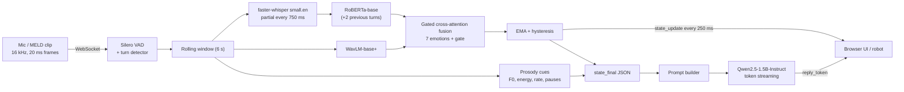

# Pip: an emotion-aware character robot (MELD, Text + Audio)

A small, fully local, streaming prototype. A person talks; the system transcribes while they speak, fuses **what they
said (text)** with **how they said it (audio)** into a MELD emotion state that updates every 250 ms, and streams a short
in-character reply that is conditioned on that state and on prosody cues.

- **Track:** Text + Audio (vision is a documented extension, not built).
- **Everything runs locally.** No remote inference at runtime.
- **Parameter budget:** ≈ 2.0–2.1 B total parameters of the 6 B allowed (`make params` prints the verified number).
- Full design: [`PRD.md`](PRD.md) (approach, architecture diagrams, interface spec, risks, deviations).



---

## 1. What is verified, and what is not

Be explicit about this before you trust any number. The code was developed in a sandbox **without a GPU, without
MELD, and without access to the Hugging Face hub**, so nothing that needs those could be run there.

| Verified by the 21 automated tests (`make test`, ~15 s, CPU, no downloads) | NOT verified yet (you need to run it) |
|---|---|
| Fusion model: shapes for text/audio/fusion modes, masking (padding does not change output), backward pass, checkpoint round-trip. Uses **tiny random encoders**, not RoBERTa/WavLM | Any accuracy/F1 number: no model has been trained on MELD |
| `prepare_meld.py` on a synthetic MELD-shaped tree with real ffmpeg (context building, missing-video skipping) | The MELD download URL in `download_meld.sh` (could not be reached from the sandbox) and the real archive's folder layout |
| One optimisation step reduces loss; `evaluate()` metrics; class weights | Loading of real pretrained weights (RoBERTa, WavLM, Whisper, Silero, Qwen) |
| Turn detection, endpointing, EMA/hysteresis smoothing, prosody buckets | Real VAD/ASR/LLM behaviour, latency, VRAM, RTF |
| Streaming `Session` end to end with fake ASR/engine: event order, mismatch flag, barge-in cancelling a streaming reply | Browser UI (`web/index.html`) in an actual browser with a microphone |
| WebSocket server round-trip + session log file | The grounding quality of real LLM replies (only the rule-based harness and the template baseline were run) |
| Tokenizer left-truncation regression test | `streaming_eval.py`, `benchmark.py`, `count_params.py`, `transcribe_meld.py` (compile-checked only; they need the models) |

Expect to fix small integration issues on first contact with real weights (library version drift, MELD folder
names). Everything is configurable in `configs/`.

---

## 2. Quick start

### 2.1 Hardware (estimates, replace with your measured numbers from `make bench`)

| Use | Suggested | Rough need (estimate, not measured) |
|---|---|---|
| Run the demo | NVIDIA GPU ≥ 8 GB, or Apple Silicon 16 GB | ~5–6 GB VRAM with Qwen 1.5B in bf16; ~3–4 GB with 4-bit |
| Train all stages | NVIDIA GPU 16–24 GB | lower `batch_size` / raise `grad_accum` in `configs/train.yaml` if you hit OOM |
| CPU only | works, slowly | use `llm.backend: template`, `asr.model: base.en`, `vad.backend: energy`; replies are rule-based |

Disk: ~12 GB for MELD raw + ~2 GB for extracted audio + model caches.

### 2.2 Install

```bash
python -m venv .venv && source .venv/bin/activate
pip install -r requirements.txt && pip install -e .     # or: make setup
# ffmpeg must be on PATH (audio extraction):  sudo apt install ffmpeg   /   brew install ffmpeg
make test                                               # sanity check, no downloads
```
`bitsandbytes` (4-bit LLM) is optional and CUDA-only; uncomment it in `requirements.txt` if wanted.

### 2.3 Data

```bash
bash scripts/download_meld.sh            # ~10 GB. If the URL is dead, download MELD manually (see script header)
python scripts/prepare_meld.py --config configs/data.yaml
```
Produces `data/processed/{train,dev,test}.jsonl` and 16 kHz wavs. Clips with a missing/broken video are skipped and
counted in `data/processed/summary.json`. MELD is released for research use; check its licence before redistributing.

### 2.4 Train (three stages, each reports its own number)

```bash
python -m meld_robot.train.train --stage text   --config configs/train.yaml   # RoBERTa + 2-turn context
python -m meld_robot.train.train --stage audio  --config configs/train.yaml   # WavLM + attentive pooling
python -m meld_robot.train.train --stage fusion --config configs/train.yaml   # warm-starts from the two above
# smoke test on a few rows first:  add  --limit 64 --epochs 1
```
Outputs `checkpoints/<stage>/best.pt` (best dev weighted-F1) and `results/<stage>_metrics.json` (test metrics).

### 2.5 Evaluate

```bash
make eval        # offline (fusion), streaming, grounding
python -m meld_robot.eval.offline_eval --ckpt checkpoints/text/best.pt  --split test
python -m meld_robot.eval.offline_eval --ckpt checkpoints/audio/best.pt --split test

# ASR gap: train/test text is gold, live text is Whisper's
python scripts/transcribe_meld.py --split test            # also prints WER vs gold
python -m meld_robot.eval.offline_eval --ckpt checkpoints/fusion/best.pt --split test --asr-text data/processed/asr_test.json
```

### 2.6 Run it

```bash
make serve                                   # http://127.0.0.1:8000  (mic button or "Replay audio file")
make demo CLIP=data/processed/audio/test/dia0_utt3.wav      # one clip through every stage, printed in the terminal
python demo/replay_demo.py --clip x.wav --energy-vad --template-llm   # no Silero / LLM downloads
python demo/replay_demo.py --ws ws://127.0.0.1:8000/stream --clip x.wav   # against a running server
```
The browser mic needs `localhost` or HTTPS.

### 2.7 Report resources

```bash
make params      # per-component parameter table, asserts <= 6B
make bench       # latency percentiles, RTF, VRAM, RAM -> results/benchmark.json
```

---

## 3. How it works

**Definition of real-time (assumption).** Conversational, not hard real-time: the emotion state refreshes every
**250 ms** while the user speaks (partial transcript every 750 ms), and the first reply token should appear within
**~1 s** of the user finishing. These are targets; `make bench` reports what your machine achieves.

**Streaming.** Audio arrives as 20 ms PCM frames. Silero VAD (32 ms windows) feeds a turn detector (300 ms debounce,
500 ms endpoint silence). While listening, the last 6 s of audio plus the latest partial transcript go through the fused
model; an EMA with hysteresis stabilises the reported label. At the endpoint, a final transcript and a final fused
prediction produce the `state_final` JSON, then the LLM streams the reply. New speech during thinking/responding is a
**barge-in**: the reply is cancelled and generation stops. Time decisions use the audio clock, so a file replayed
faster than real time behaves like live input.

**Model.** RoBERTa (current utterance + previous 2 turns) and WavLM (weighted sum of layers) are projected to 256-d,
cross-attend to each other, are attentively pooled, and are mixed by a learned gate `g` (the "which signal drove it"
bar in the UI). Per-modality auxiliary heads provide extra training signal and the text-only view that raises the
`mismatch` flag ("words sound neutral, voice says anger").

**Grounded reply.** The prompt contains the emotion (with coarse confidence), sentiment, prosody summary, the mismatch
note and a tone guide, never raw probabilities. See `src/meld_robot/respond/prompt.py`.

### Event example (`state_final`)

```json
{
  "type": "state_final", "text": "No, it's fine.",
  "emotion": {"label": "anger", "confidence": 0.58, "probs": {"anger": 0.58, "neutral": 0.27, "...": 0.0}},
  "sentiment": "negative",
  "prosody": {"pitch": "low", "pitch_var": "flat", "energy": "high", "rate": "fast", "pauses": "few"},
  "text_emotion": "neutral", "mismatch": true,
  "modality_weight": {"text": 0.35, "audio": 0.65},
  "latency_ms": {"asr": 210.0, "encode_fuse": 55.0, "prosody": 12.0}
}
```
(Illustrative values. The tests use a fake engine that produces exactly this shape.)

Other events: `turn`, `state_update`, `reply_token`, `reply_done`, `barge_in`, `reply_cancelled`. Protocol details in
`src/meld_robot/server/app.py` and `PRD.md` §7.

---

## 4. Results (fill in after running; none were produced in the build sandbox)

| Model (MELD test, 7 classes) | Weighted-F1 | Macro-F1 | Source file |
|---|---|---|---|
| Text only (RoBERTa + context) | _TBD_ | _TBD_ | `results/text_metrics.json` |
| Audio only (WavLM) | _TBD_ | _TBD_ | `results/audio_metrics.json` |
| **Fused (gated cross-attention)** | _TBD_ | _TBD_ | `results/fusion_metrics.json` |
| Fused, Whisper transcripts instead of gold text | _TBD_ | _TBD_ | `results/offline_fusion_test_asr.json` |

| Streaming / latency (your hardware) | Value |
|---|---|
| Accuracy when 25 / 50 / 75 / 100 % of the utterance has been heard | _TBD_ (`results/streaming_eval.json`) |
| Label flips per utterance: raw argmax vs EMA + hysteresis | _TBD_ |
| End-of-utterance → first reply token (p50 / p95) | _TBD_ (`results/benchmark.json`) |
| Peak VRAM / RAM, ASR real-time factor | _TBD_ |
| Rule-based grounding pass rate with the real LLM | _TBD_ (`make eval`) |

Context for the numbers you will get: MELD is imbalanced (neutral ≈ 47 %) and noisy (TV audio, laughter tracks,
overlapping speech), published models land around the low-to-mid 0.60s weighted-F1, and rare classes (fear, disgust)
are hard. Report macro-F1 and the per-class table alongside weighted-F1.

**On the grounding check.** `make eval` runs transparent rule checks (length, tone register, no celebratory words for
negative emotions, acknowledging tone on mismatch, and a contrast test: same words + different tone ⇒ different
reply). The rule lexicons are simple and the rule-based **template responder passes them by design** (the test suite
asserts this as a regression baseline), so the informative run is the real LLM. Add a manual review of ~30 replies
(grounded / generic / contradictory) to your write-up; the harness prints every reply for that purpose.

---

## 5. Configuration cheatsheet (`configs/stream.yaml`)

| Key | Effect |
|---|---|
| `streaming.emotion_hop_ms` / `asr_hop_ms` | State-update rate vs ASR cost |
| `streaming.ema_alpha`, `switch_margin` | Reactivity vs flicker of the reported label |
| `turn.endpoint_silence_ms` | Larger = fewer cut-offs, slower replies |
| `asr.model` | `small.en` (244 M) or `base.en` (74 M) |
| `llm.model`, `llm.quantization` | e.g. `Qwen/Qwen2.5-0.5B-Instruct` for tight hardware; `4bit` on CUDA |
| `llm.backend: template` | No LLM; rule-based replies |
| `vad.backend: energy` | No Silero download |

---

## 6. Completed vs intentionally left out

**Completed:** data prep, three-stage training, fused text+audio model, streaming session (VAD, turn-taking, partial
ASR, smoothing, barge-in), prosody cues, grounded streamed replies, WebSocket server, browser UI with mic and file
replay, terminal replay demo, offline/streaming/grounding evaluation, parameter and resource reporting, 21 tests.

**Intentionally left out:** the vision modality and the three-way vision+voice+text extension; text-to-speech;
reinforcement learning; speaker diarisation; production hardening (auth, multi-user scaling). The PRD (§14) sketches
how each would slot in; the parameter budget leaves ample room.

## 7. Limitations and risks

- **Train/serve mismatch:** trained on gold MELD transcripts, served on Whisper text; training context carries MELD
  speaker names while live context uses "User"/"Pip". Measure with `--asr-text`.
- **Acted TV speech ≠ everyday speech;** laughter tracks and music in MELD audio can mislead the audio branch.
- **Rare classes** (fear, disgust) will be weak; check per-class F1 and the confusion matrix.
- **Prosody buckets are speaker-independent heuristics** (cues, not ground truth); pitch buckets will be off for
  unusual voices.
- **Partial-text streaming** re-transcribes the rolling window, so partial words can change between updates.
- **LLM replies can still drift** from the state; the prompt, tone guide and rule checks reduce but do not eliminate this.
- A 4-bit LLM is still counted at its full logical parameter size in the budget.

## 8. Third-party components and AI-assistance

Pretrained components (each under its own licence, verify before redistribution): RoBERTa-base, WavLM-base-plus,
OpenAI Whisper via faster-whisper, Silero VAD, Qwen2.5-1.5B-Instruct; dataset: MELD (Poria et al.). This repository
was written with an AI assistant; the author is responsible for the code, experiments and decisions and should be able
to explain and modify every part (tests are there to make changes safe).

## 9. Repository layout

See [`PRD.md`](PRD.md) §10. In short: `src/meld_robot/{models,train,eval,stream,respond,server}`, `scripts/`,
`configs/`, `web/`, `demo/`, `tests/`, `eval_cases/`.
